# Campus Helpdesk — Campus Service Desk

**DevSecOps Capstone · Session 21**

Campus Helpdesk is a support-ticket system for students and campus staff. Students report IT,
facilities, classroom, or account issues. Service staff triage requests, set priority, assign an
owner, and follow each request through to resolution. The service desk dashboard highlights the
open queue, urgent tickets, response targets, and resolution progress.

The project demonstrates an application lifecycle rather than a collection of disconnected tools:
React and FastAPI run locally with PostgreSQL, tests gate the container build, Trivy scans images
before GHCR publication, Terraform provisions AWS networking and EKS, Argo CD reconciles the Helm
release, and Prometheus/Grafana provide operational visibility.

> Deployment evidence is added only after a real run. In particular, local Docker or kind output
> is not presented as proof of AWS, GitHub Actions, GHCR, or Argo CD deployment.

## Submission Evidence

The following screenshots document real local runs. Minikube screenshots show a local Kubernetes
deployment; they are not evidence of AWS/EKS. GitHub Actions and GHCR publication are verified by
[workflow run #5](https://github.com/al-2005/Capstone/actions/runs/39022994976); screenshots of that
run and the GHCR packages, AWS infrastructure, Argo CD, and the final presentation video remain
pending.

### M1 — Application

Campus Helpdesk running locally with sample tickets:

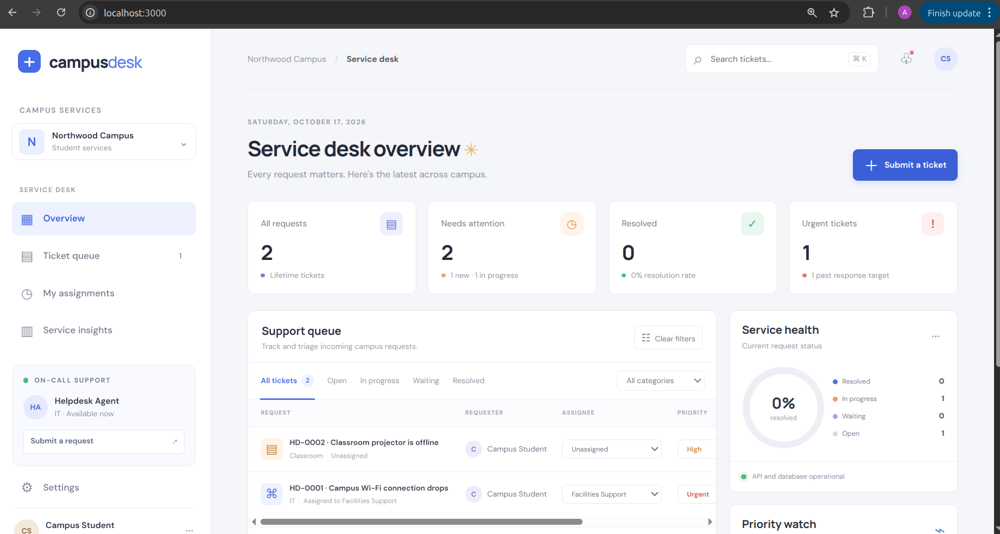

FastAPI API documentation:

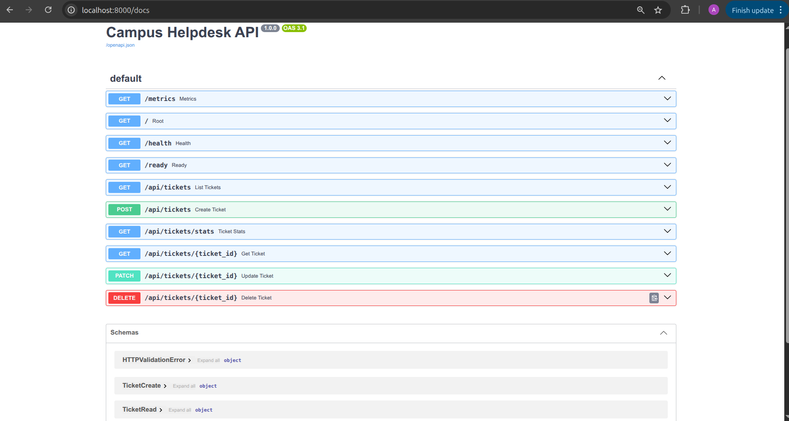

### M2 — Testing

Backend test run:

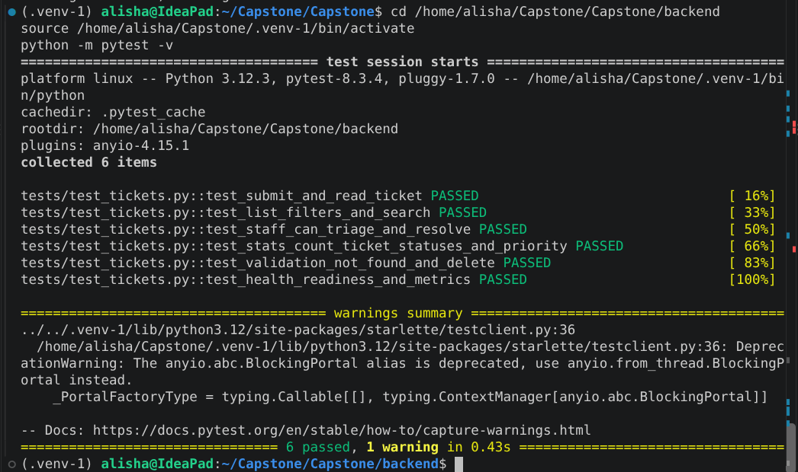

### M3 — Git and GitHub

Local Git status/history evidence:

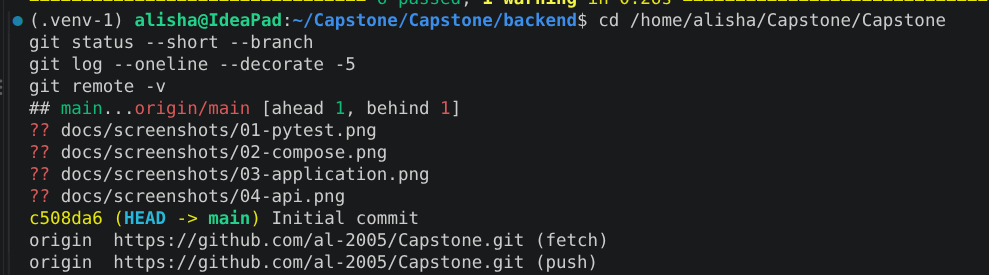

### M4 — Docker and frontend build

Local Docker service status:

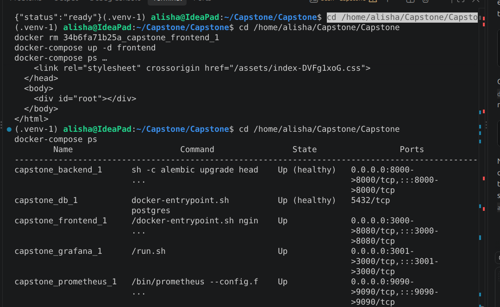

Frontend production build and post-update npm audit:

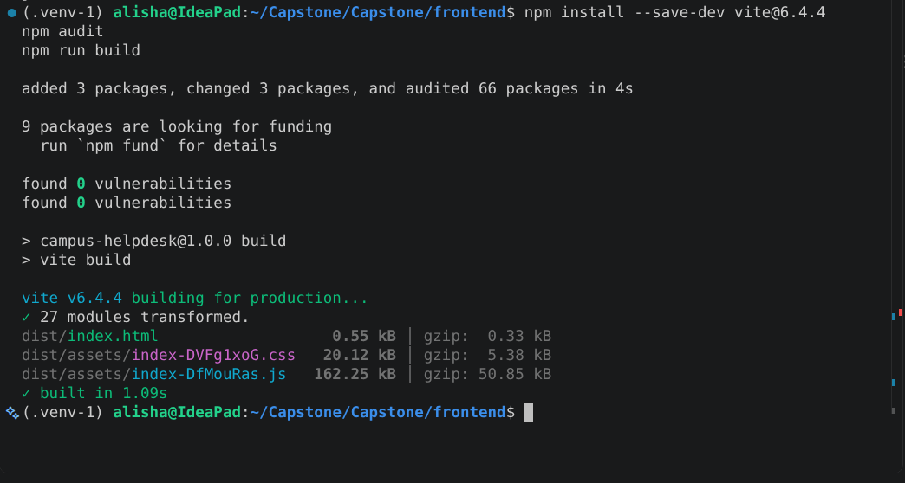

### M6 — Dependency security

The initial npm audit reported Vite/esbuild vulnerabilities. Vite was updated to 6.4.4; the
subsequent audit reported zero vulnerabilities. The screenshot above records the updated build and
audit, while this capture records the earlier findings:

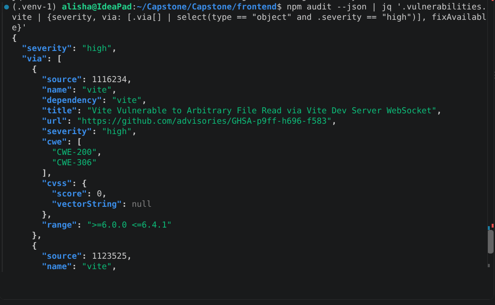

### M8 — Local Kubernetes, Helm, and Ingress

Minikube cluster readiness:

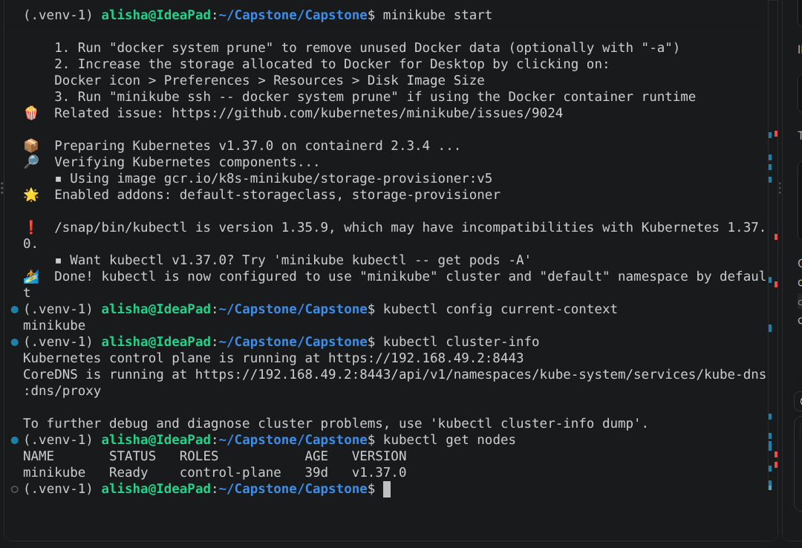

Helm lint and rendered resources:

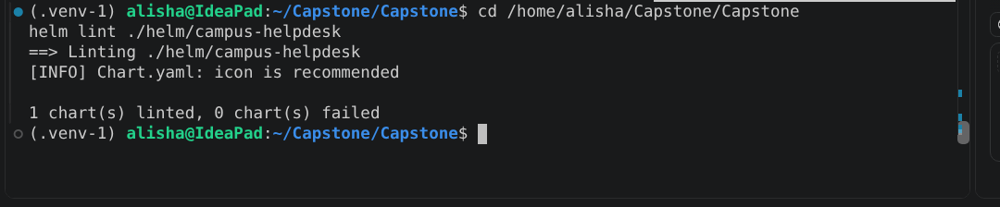

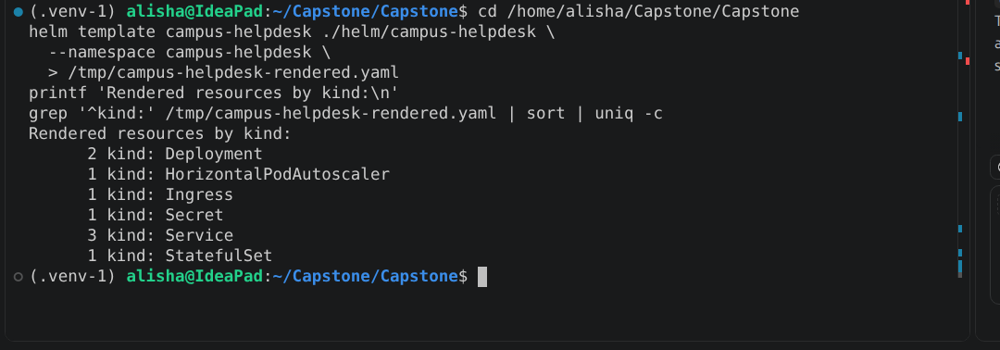

Local images, Ingress controller, and Helm release:

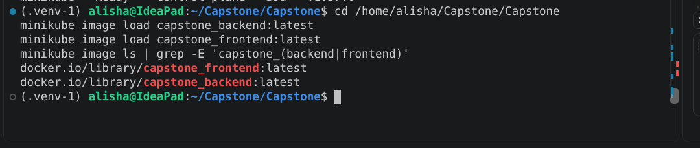

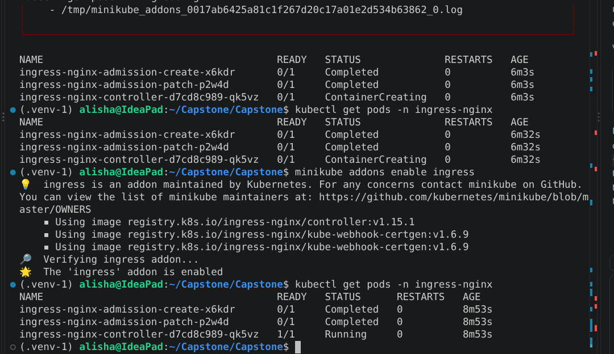

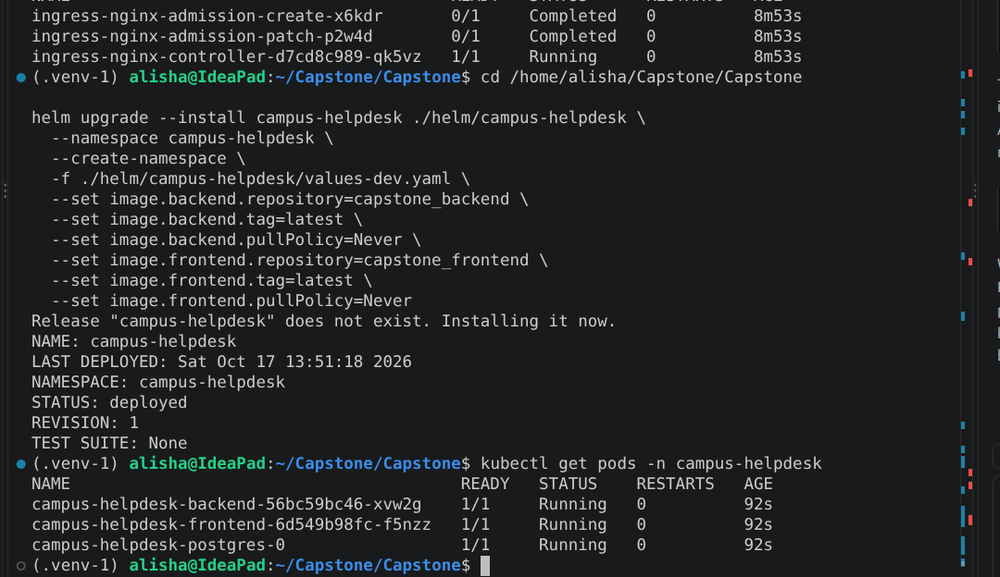

Services, Ingress, and release status:

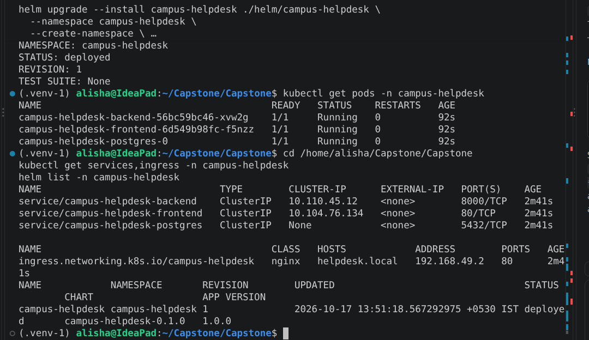

Application reached through the local Ingress hostname:

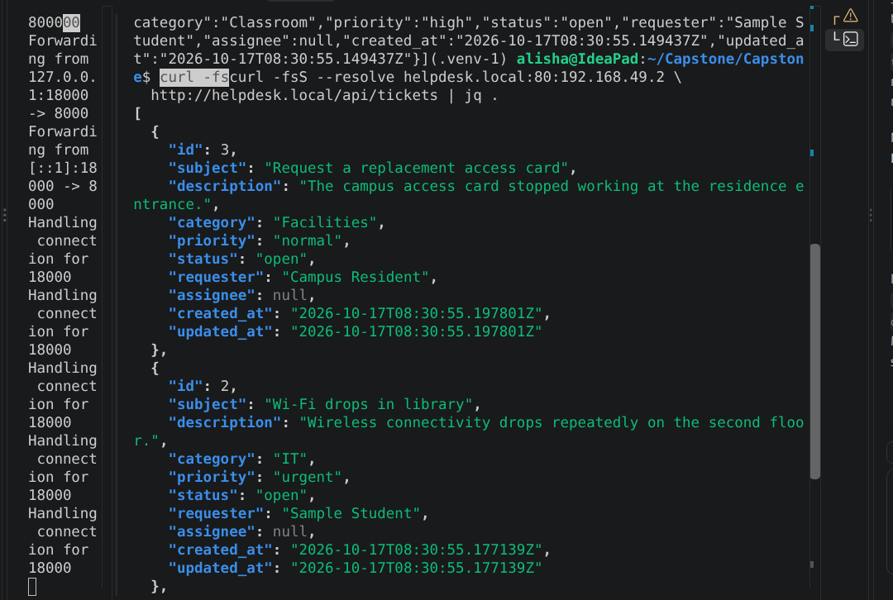

### M9 — Local observability

Prometheus-format application metrics:

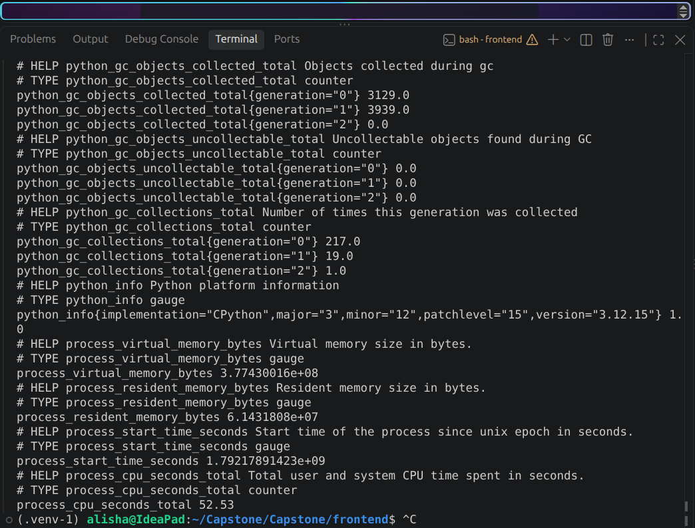

Prometheus target health:

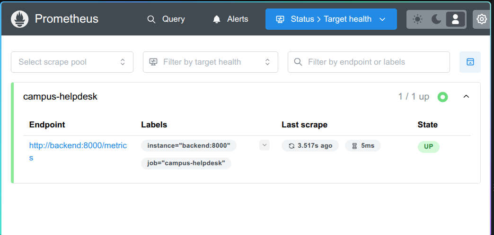

Grafana dashboard:

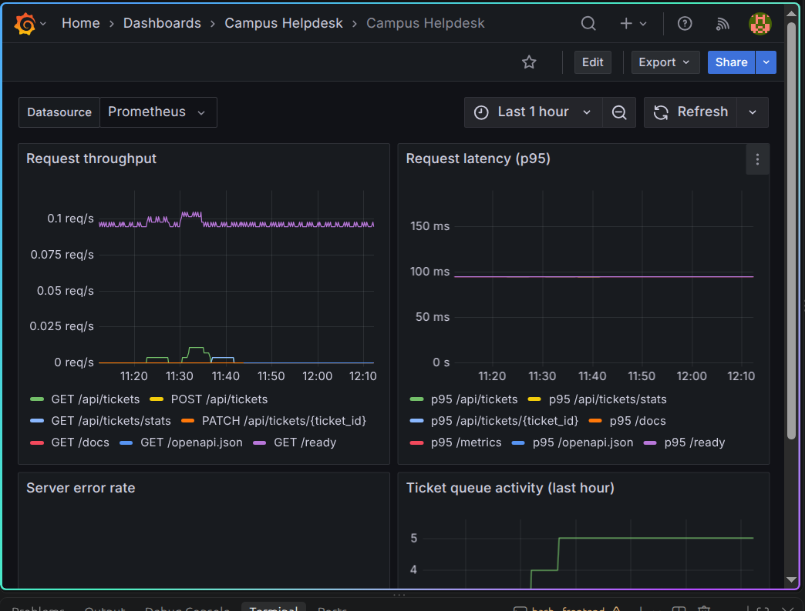

### Remaining submission evidence

- **M5/M6:** GitHub Actions, Trivy scans, and GHCR publication are verified by
  [workflow run #5](https://github.com/al-2005/Capstone/actions/runs/39022994976); submission
  screenshots of the run, scans, and GHCR package page are still pending.
- **M7:** Terraform plan and AWS VPC/EKS deployment are pending.
- **M8 GitOps:** Argo CD sync/health evidence is pending. The completed Kubernetes evidence above
  is from local Minikube.
- **M10:** The narrated presentation video is pending; see [`demo/RECORDING.md`](demo/RECORDING.md)
  for the recording sequence.

---

## Architecture

```text
Student / service staff
          │
          ▼
 Browser ── / ────────────┐
          └─ /api ──────┐  │
                       ▼  ▼
                NGINX Ingress
                  │       │
           React + Vite   FastAPI REST API ───── /metrics ────┐
                           │                                  │
                       PostgreSQL                    Prometheus Operator
                                                              │
                                                           Grafana

 Developer ── git push ──> GitHub
                               │
                        GitHub Actions
                   pytest + frontend build
                   Docker build + Trivy scan
                       publish SHA images
                               │
                      GitHub Container Registry

 Terraform ──> AWS VPC + EKS ──> Argo CD watches Git
                                      │
                                    Helm
                                      │
                           Campus Helpdesk workloads
```

## Repository layout

```text
backend/                    FastAPI API, SQLAlchemy model, Alembic, pytest
frontend/                   React + Vite service desk dashboard
docker-compose.yml          PostgreSQL, API, UI; optional monitoring profile
.github/workflows/          Test, build, scan, and publish workflow
terraform/                  AWS VPC and EKS infrastructure
k8s/                        Namespace and cluster bootstrap manifests
helm/campus-helpdesk/       Deployments, Services, ingress, HPA, database, monitoring
argocd/                     GitOps Application definition
monitoring/                 Prometheus and Grafana configuration
scripts/                    Demo data, load generation, evidence helpers
troubleshooting/            Deliberately broken Kubernetes manifests
docs/screenshots/            Evidence checklist; capture authentic command and UI screenshots here
demo/                       Presentation deck/source and video recording/submission checklist
```

---

## M1 — Application (FastAPI + PostgreSQL + React)

Students can submit requests; service staff can search/filter, triage, assign, and resolve them.
The dashboard summarizes the service queue and highlights urgent and SLA-overdue requests.

| Method | Endpoint | Purpose |
|---|---|---|
| GET | `/health` | Liveness: the API process is running |
| GET | `/ready` | Readiness: the database can answer a query |
| GET | `/metrics` | Prometheus-format HTTP metrics |
| GET | `/api/tickets` | List and filter requests by status, category, priority, or search |
| GET | `/api/tickets/{id}` | Read one request |
| POST | `/api/tickets` | Submit a campus support request |
| PATCH | `/api/tickets/{id}` | Update status, priority, or assignee |
| DELETE | `/api/tickets/{id}` | Remove a request |
| GET | `/api/tickets/stats` | Dashboard counts and response-target summary |

The PostgreSQL schema is managed through Alembic. API validation uses Pydantic; tests use an
isolated SQLite database so they do not depend on a running PostgreSQL service.

**Evidence to capture:** browser dashboard, submitted ticket, and `/docs` API page under
`docs/screenshots/`.

## M2 — Testing and code quality

`backend/tests/` covers ticket creation and retrieval, filtering/search, staff updates, dashboard
statistics, deletion, invalid input, missing ticket handling, health/readiness, and metrics.

```bash
cd backend
python -m venv .venv
source .venv/bin/activate
pip install -r requirements-dev.txt
pytest -v
```

**Evidence to capture:** full passing test output at `docs/screenshots/01-pytest.png`.

## M3 — Git and GitHub

Use commits to record reviewable changes and a GitHub repository as the shared source of truth.
Keep `.env`, credentials, kubeconfig, Terraform state, virtual environments, and build outputs out
of Git. Require successful CI checks before merging changes to the default branch.

```bash
git status
git log --oneline --decorate -10
git remote -v
```

**Evidence to capture:** repository page and commit history at `docs/screenshots/`.

## M4 — Docker

- `backend/Dockerfile` installs pinned Python dependencies and runs the API as a non-root user.
- `frontend/Dockerfile` builds static assets in a Node stage and serves them with unprivileged NGINX.
- `docker-compose.yml` starts PostgreSQL, API, and frontend in dependency/health-check order.
- The frontend calls same-origin `/api`; NGINX proxies requests to the API service.

```bash
docker compose up --build -d
./scripts/seed-demo.sh
docker compose ps
curl -fsS http://localhost:8000/ready
curl -fsS http://localhost:8000/api/tickets
```

Open `http://localhost:3000`. Use `docker compose down` to stop the stack. Use `docker compose
down -v` only when intentionally deleting the local database volume and demo data.

**Evidence to capture:** Compose status, health/API responses, and application browser page.

## M5 — CI/CD (GitHub Actions)

`.github/workflows/ci-cd.yml` runs on pull requests and pushes to the default branch:

1. **Test:** install backend requirements, run pytest, install frontend lockfile dependencies,
   and build the frontend.
2. **Build and scan:** build backend and frontend container images and scan each with Trivy.
3. **Publish:** push the images to GHCR tagged with the commit SHA only after tests and scans pass.

The commit-SHA tag connects a published image back to its source revision. Argo CD performs
deployment reconciliation from Git rather than having the build pipeline mutate the cluster.

Verified on 2026-10-17: [workflow run #5](https://github.com/al-2005/Capstone/actions/runs/39022994976)
passed the tests, frontend build, image builds, Trivy scans, and GHCR publication for commit
`c59ea4c`. Capture the successful run, job details, and GHCR package page for the submission.

## M6 — DevSecOps (Trivy)

Trivy scans both built images for HIGH and CRITICAL vulnerabilities. The workflow fails the
publish gate when a matching vulnerability is found. The latest successful run passed both image
scans; earlier runs correctly blocked publishing when findings were present. Container scanning is
one layer of defense; it does not replace dependency review, secret scanning, secure configuration,
or runtime controls.

**Evidence to capture:** Trivy output from the same workflow run as the published images. Report
findings honestly; do not describe an unrun scan as clean.

## M7 — Terraform (AWS VPC + EKS)

`terraform/` declares the cloud infrastructure as code: an AWS VPC with public/private subnets,
networking and NAT, an EKS control plane, and managed worker nodes. The default region is
`ap-south-1`. Review cost estimates before applying; EKS, NAT gateways, and EC2 nodes are billable.
Never commit cloud credentials or Terraform state.

```bash
cd terraform
terraform init
terraform fmt -check
terraform validate
terraform plan
terraform apply
aws eks update-kubeconfig --region ap-south-1 --name campus-helpdesk
# Destroy the billable demo infrastructure when finished:
terraform destroy
```

**Evidence to capture:** actual `terraform plan` and destroy output plus AWS Console proof of the
VPC and active EKS cluster. A local plan is not evidence that AWS resources were created.

## M8 — Kubernetes + Helm + Argo CD

Helm packages the application resources; Argo CD observes the configured Git repository and
reconciles the desired release state. Set the repository URL, branch, and real SHA-tagged GHCR
images before applying the Argo CD Application.

```bash
kubectl apply -f k8s/namespace.yaml
helm repo add ingress-nginx https://kubernetes.github.io/ingress-nginx
helm repo add metrics-server https://kubernetes-sigs.github.io/metrics-server/
helm repo update
helm upgrade --install ingress-nginx ingress-nginx/ingress-nginx \
  --namespace ingress-nginx --create-namespace
helm upgrade --install metrics-server metrics-server/metrics-server \
  --namespace kube-system
kubectl apply -f argocd/application.yaml
kubectl get applications -n argocd
kubectl get pods,services,ingress -n campus-helpdesk
kubectl get service ingress-nginx-controller -n ingress-nginx
helm list -n campus-helpdesk
```

The chart includes the UI and API Deployments/Services, PostgreSQL with persistent storage,
liveness/readiness probes, ingress routes, a CPU HPA, an optional Prometheus ServiceMonitor, and a
Grafana dashboard ConfigMap for the Prometheus Operator sidecar. The NGINX Ingress Controller and
Metrics Server are installed separately because an Ingress resource does not implement routing by
itself, and HPA needs a metrics API. Create a DNS record for the Ingress load-balancer address or
test with `curl -H 'Host: helpdesk.local' http://<INGRESS-LOAD-BALANCER>` after it is provisioned.
The local Postgres-in-cluster setup is for a learning demo; managed database services are a
better production choice. HPA requires Metrics Server and resource requests.

**Evidence to capture:** Argo CD application synced/healthy, Helm release, running pods, Services,
Ingress, and application reachable through Ingress.

## M9 — Observability (Prometheus + Grafana)

The API exposes `/metrics`. Prometheus Operator discovery uses the chart's ServiceMonitor to
scrape the API; Grafana visualizes request volume, latency, status codes, and service health.

For local Compose monitoring:

```bash
docker compose --profile observability up --build
```

Prometheus is available at `http://localhost:9090`; Grafana is at `http://localhost:3001`.
For Kubernetes, install `kube-prometheus-stack` and enable the chart's ServiceMonitor; detailed
commands are in `monitoring/README.md`.

**Evidence to capture:** `/metrics` output, Prometheus Targets showing the application `UP`, and
a populated Grafana panel. Capture real running services rather than illustrative mockups.

## Troubleshooting labs

`troubleshooting/` contains deliberately broken examples for diagnosing `ImagePullBackOff` and a
Service with no matching endpoints. Apply them only in a disposable namespace, inspect Pods,
events, labels and endpoints, then remove the lab resources.

**Evidence to capture:** the failing state, diagnostic commands, and corrected state.

## M10 — Presentation, documentation, and submission

The `demo/` folder contains the slide deck, recording checklist, evidence index, and the required
presentation video once recorded. The video begins with the slides and then walks through the
codebase, CI/CD, Terraform/AWS, Argo CD, Kubernetes/Ingress, Prometheus, and Grafana, in the order
listed in `demo/RECORDING.md`.

The submission requires one GitHub repository link. Submit it through the course form:
[DevSecOps Capstone submission form](https://forms.gle/XWAP1vAumDJgAPM1A).

**Screenshots and video are evidence of commands actually run.** Take terminal screenshots in
your own terminal window with its real prompt/terminal username and hostname visible; do not crop
that identity out or add a made-up name to the screenshot. Run `scripts/run-evidence.sh <command>
[args...]` to label and log commands with the current terminal identity. Save genuine screenshots
with readable, matching filenames in `docs/screenshots/`, and review command logs for secrets
before sharing. The video, PPT or PDF deck, AWS Console proof, and live GitHub Actions run must be
produced from the real account and environment before submission.

## Known limitations and completion status

- This demo does not provide student/staff authentication, email notifications, file attachments,
  or a production-grade SLA policy.
- AWS, GitHub Actions, GHCR, and Argo CD status depends on credentials, account setup, and a
  successful deployment; document what was actually run.
- AWS resources incur charges. Review the plan and destroy temporary infrastructure after use.
- Keep real screenshots, generated presentation assets, and recordings in their documented
  locations; avoid committing credentials, tokens, cluster configs, or Terraform state.
